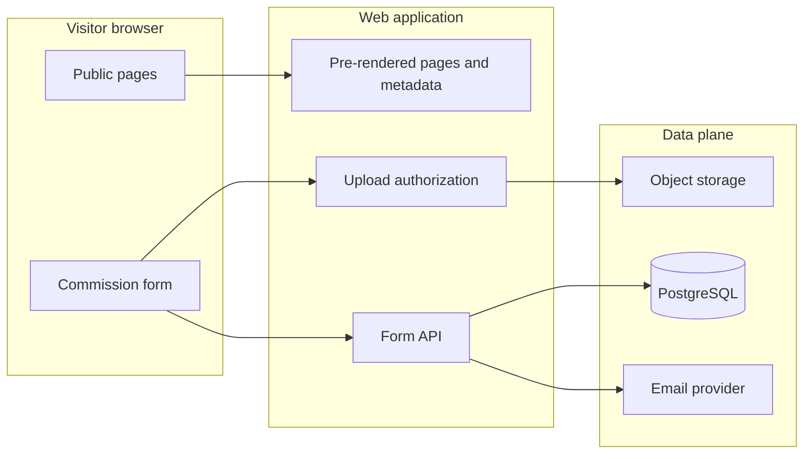
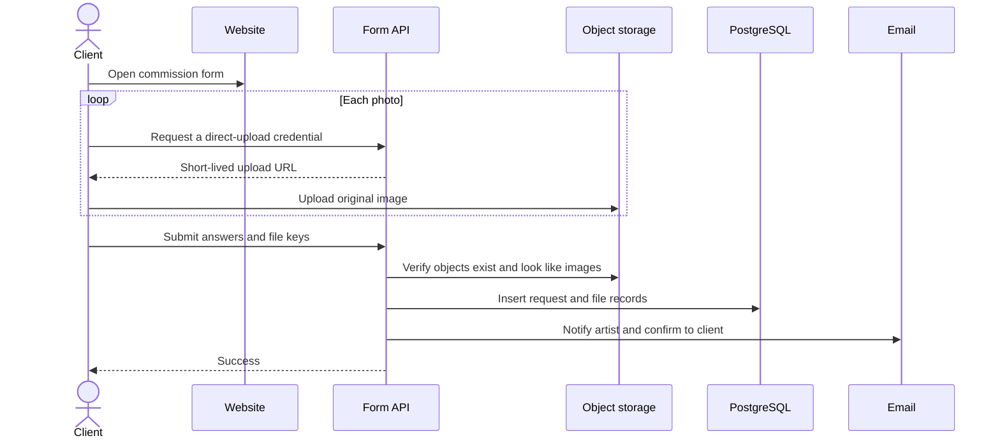

# Architecture

This describes the system to build, not code that already exists. The repository is starting from documentation only. Public-site visual and interaction design lives in [ui-ux.md](ui-ux.md).

The design favors a small, factual public site that is easy for people and AI systems to read, plus a sturdy intake path for large reference photos. Volume will be low (about one accepted commission a month), but each request can include many large original images, so uploads are the main technical risk.

## Design principles

- Mobile-first pages that also work well on desktop.
- Traditional Chinese (Hong Kong) as the default language, with a full English equivalent and correct `hreflang`.
- Marketing and policy pages are pre-rendered HTML, not client-only apps, so they stay crawlable.
- The commission form does not require a Google (or any) sign-in.
- Original client photos go straight to object storage. They must not pass through a server with a small request-body limit.
- Private request data, especially cat living-status, never appears on public pages, in sitemaps, or in structured data.
- Keep v1 operable by one person: form in, files stored, email out.

## High-level shape

## Components

### Public website

Pre-rendered pages for Home, Works, The halo, Process, About, Commission, and FAQ, plus a language switch. These pages carry the canonical facts (price, sizes, lead time, what is not offered, payment and delivery, consent rules) and JSON-LD structured data.

Images on marketing pages are the studio’s own finished-work photographs, optimized for the web. They are separate from client reference uploads.

### Commission form and form API

The form runs in the browser and submits answers to a server route in the same application. Before submit, each photo is uploaded directly to object storage using a short-lived, server-issued credential (a pre-signed URL or an equivalent direct-upload token). The API then stores one request record that points at those objects, and sends email.

Validation happens both in the browser (for a decent mobile experience) and again on the server (so required consents and email format cannot be skipped). The server should also check that uploaded objects exist, are images, and stay within the agreed limits (two upload groups, up to 10 files each, 100 MB per file).

The current Google Form’s “up to 10 files / 100 MB” cap is the starting rule. Twenty files at 100 MB is a worst case of about 2 GB per request. Storage and upload design must allow that, even if typical requests are smaller. The UI should still encourage 8–10 clear photos rather than maximum file size.

### Object storage

A private bucket holds original reference photos. Objects are not publicly listable. The artist receives access through signed, time-limited download links in the notification email (and later, in admin). Do not run these originals through a public CDN with guessable URLs.

Keep originals as uploaded. Do not replace them with compressed derivatives. Optional smaller previews may be generated later for an admin grid, as long as the original remains available.

### Database

A single PostgreSQL database stores commission requests and, later, order-management state. v1 needs at least:

- Request identity and timestamps
- Language used to submit
- Contact and commission fields listed in [core functions](core-functions.md)
- Storage keys for each uploaded file (group, original filename, size, type)
- Consent records (terms, handmade-likeness acknowledgement, publicity / tagging)
- Submission status (received, or failed if mail or storage did not complete)

Cat living-status should be stored as ordinary private application data, but it must be excluded from logs, analytics, public APIs, and any export that might be used for marketing.

### Email

Transactional email is the artist’s inbox in v1:

- To the studio: new request, answers, and signed links to the photos
- To the client: a simple “we received your request” message, with no need to repeat private status fields

If email delivery fails after the request is stored, the failure should be visible to the studio (for example a retry or an alert), so a request is not silently lost.

### Phase 2: admin portal

A private, authenticated admin portal in the same application. It should not be linked from the public navigation in a way that invites visitors to sign in. This can wait until after the public site and form are live.

Two areas:

- **Commissions** — read the same database and private storage bucket to manage commission details and status: queue, full request view, photo access, photo sufficiency, scheduled month, payment notes, revisions, and handover.
- **Public content** — manage the Works showcase and Home page components: finished-work entries, bilingual captions, featured selection for Home, and studio marketing images. These public assets use a separate storage path or bucket from private client reference uploads. Nothing private from a commission record is published through this path.

## Commission data flow (v1)

If verification fails, nothing is marked as received, and the client is asked to retry the missing files. Incomplete or abandoned uploads should be expired and cleaned up so the bucket does not keep orphaned files forever.

## Environments

- **Production** — the public site and live form.
- **Preview / staging** — optional, but useful so form and email can be tested without writing to the production inbox or bucket.
- **Local development** — the app, a database, and either a local or development bucket.

Production and staging must use separate databases, buckets, and email recipients. Do not put secrets in the repository.

The public site should run on HTTPS on a domain chosen later (open decision). Instagram and Threads remain the social profiles; the site should use the same brand name, nuttyfelt.

## Security and privacy

- No login on the public form. Rate-limit submissions and upload-credential requests to reduce spam and abuse.
- Validate file type from content, not only the filename, and reject non-images.
- Signed upload URLs should be scoped to a single object, a short expiry, and the declared size/type where the storage API allows it.
- Artist download links should expire. The database remains the source of truth for who may see a request.
- Do not log full form bodies, WhatsApp numbers, or living-status in application or analytics logs.
- Living-status, WhatsApp, and email are personal data. Keep them in the request record for studio use only. There is no public “client stories” feed in v1.
- Publicity consent is required to accept an order, but consent to publish is not a reason to publish living-status or contact details.
- The existing Google Form records the Google account used to submit. The first-party form should not depend on Google identity. Record the email the client types, and the time of submit.

## GEO (Generative Engine Optimization)

GEO here means making the studio easy to describe accurately in AI search and answer engines, by publishing stable facts in ordinary HTML and in structured data. It is not local-map SEO, unless a public address is added later.

Approach:

- Each important topic has a crawlable page (process, halo, FAQ, works, commission).
- Facts are consistent everywhere: price, halo sizes (13 cm / 15 cm), lead time, monthly capacity, what is not offered, Hong Kong base, payment methods, and South Island Line or SF Express handover.
- Add JSON-LD for `Organization`, `Offer` / product-style service description, `FAQPage`, and breadcrumbs where they fit. Use `inLanguage` and bilingual `hreflang` (`zh-Hant` and `en`).
- Provide `sitemap.xml`, `robots.txt`, and descriptive titles and meta descriptions in both languages.
- Use a factual `llms.txt` (and, if useful, markdown mirrors of the policy/FAQ pages) so answer engines can fetch a clean summary.
- Do not put key facts only inside images, Instagram embeds, or client-side scripts.
- Do not include client names, private stories, or living-status in structured data or `llms.txt`.
- Finished-work pages should say the pieces are handmade custom portraits, not stock products available off the shelf.

## What this architecture deliberately does not include in v1

- Payment capture (FPS, PayMe, and PayPal stay off-site)
- Client accounts
- Real-time chat
- A public inventory or booking calendar (capacity is communicated as “about one commission a month,” and the artist confirms the month by hand)
