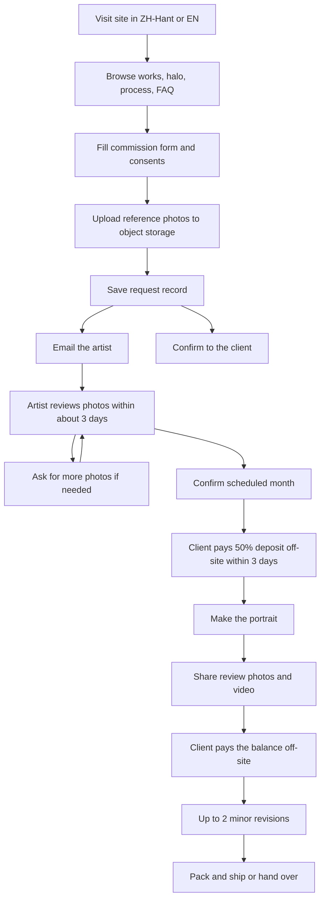

# Core functions

Nuttyfelt’s website has four jobs: promote the brand, show finished work, take and later manage custom portrait commissions, and publish accurate facts that people and AI search systems can rely on.

The studio currently takes about one commission a month, with a lead time of about 3–4 weeks. The system should stay small and reliable, not like a high-volume shop.

## Users

- **Visitor / client** — browses the public site in Traditional Chinese (Hong Kong wording) or English, reads the terms, and submits a commission request with photos. No Google account, and no account of any kind, should be required to submit a request.
- **Artist / studio** — receives new requests, judges whether the photos are enough, confirms the scheduled month, collects deposit and balance off-site, makes the work, handles up to two minor revisions, then packs and ships or hands over the piece. In v1 this happens mainly by email and the existing WhatsApp / Instagram contact. Phase 2 adds a private admin portal to manage commission details and status, plus the Works showcase and Home page content.

## Public site

| Area | Purpose |
| --- | --- |
| Home | Introduce the work with photography, the halo presentation, and a clear path to view works or start a commission. |
| Works | Showcase finished portraits (for example Chestnut / 栗子 and Yat Yat / 壹壹) with enough context for a visitor to understand the style. |
| The halo | Explain the signature presentation: a realistic half-bust fixed on a hand-polished brass/gold halo, with an easel stand, rather than a picture frame. Mention the included protective wax for the metal. |
| Process | Explain how a commission works, what is included, pricing, lead time, deposits, revisions, cancellation, payment, and delivery, matching the current 落單需知. |
| About | The studio, Hong Kong base, and the origin of the work, without publishing private client details. |
| Commission | First-party request form, including photo uploads and required consents. |
| FAQ | Short factual answers that also support GEO (price, size, lead time, what is not offered, delivery, revisions). |

The public site is mobile-first and bilingual. Traditional Chinese is the default. English is a full equivalent, not a partial translation. Language can be switched on every page.

A map pin or store locator is out of scope unless a public address is provided later.

## Commission offering (source of truth)

These facts come from the current Google Form (nuttyfelt 訂製表格) and must be reflected accurately on the site. If the studio changes a policy, update the form copy, these docs, and the live site together.

**Price and inclusions**

- Regular price: HK$5,000, the same for long- and short-hair; complex coloring is not charged extra.
- Early-bird: HK$4,250 for the first 3 clients, if they agree to an Instagram post and a written testimonial. Treat whether this offer is still open as a product fact to confirm when building, not something to invent.
- Included: a realistic needle-felted cat half-bust on a metal halo board (short-hair 13 cm, long-hair 15 cm), stand, one black-and-white hand-drawn cat portrait, and a small box of protective wax.
- Overseas: shipping and remittance fees are extra.
- Not offered: open-mouth or special expressions, collars or accessories, rush orders.

**Capacity and timing**

- Temporarily only 1 commission per month.
- Lead time is about 3–4 weeks. Slots are held in the order of a completed form plus deposit.
- The artist aims to reply within 3 days on whether the photos are sufficient and which month is scheduled.
- 50% deposit is due within 3 days of confirming details, or the slot goes to the next person.

**Making, review, and revisions**

- After completion, multi-angle photos and video are provided for review. The balance is then due, followed by up to 2 minor revisions.
- Minor revisions mean pattern placement, local color, and detail fixes. Changes to structure (muzzle proportions, nose-bridge length, eye position), the cat itself, head direction, or halo size are not minor revisions and are not available after work starts.
- The work is a handmade interpretation. Wool colors are limited, and lighting or screens can shift color.

**Cancellation**

- Before production: cancellation is allowed, but the deposit (for holding the slot and materials) is not refunded.
- After production starts: the custom work cannot be cancelled or refunded.
- If the balance is not paid, the work belongs to nuttyfelt and the deposit is not refunded.
- If the artist cannot complete on time for personal reasons, they will coordinate early and may refund if necessary.

**Payment and handover**

- Hong Kong payment: FPS, PayMe.
- Overseas payment: PayPal; remittance fees are paid by the client.
- Hong Kong delivery: SF Express freight collect (順豐到付), or in-person handover at an MTR South Island Line station (港鐵南港島線站面交).
- Overseas delivery: actual shipping cost; local duties are paid by the client.

**Sharing**

- Client cat photos, finished work, and the making process may be shared on nuttyfelt social media.
- An order is not accepted without publicity consent: either agree and allow tagging, or agree but do not tag.
- The optional “貓貓現在…” status (still with the client, has passed / 已經回到喵星, or prefer not to say) is only for adjusting communication tone. It must never be published, used in marketing, or exposed in public APIs.

## Commission request (v1 intake)

The first-party form replaces the Google Form intake. It should collect the same information, stay on one clear mobile flow, and work without a Google sign-in.

### Required

- Email
- Agreement to the 落單需知 (terms)
- 稱呼 (name to use)
- Instagram account (for contact and possible collaboration posts)
- WhatsApp number (overseas clients may enter `/`)
- Location: Hong Kong, or Other with the country named
- Cat’s name
- Coat length: short hair (13 cm halo) or long hair (15 cm halo)
- Features the client most wants preserved
- Basic-angle photos: 8–10 original, unfiltered images covering front, eye close-up, left, right, back, 45°, top, and low angle
- A best representative front photo, plus extra pattern or marking photos if relevant
- Acknowledgement that the work is a handmade interpretation and will not match photos exactly
- Publicity consent (may tag / please do not tag)

### Optional

- How they found nuttyfelt (IG, Threads, friend, other)
- Sex / breed
- Cat’s current status (private, as above)
- Stories they want to share about the cat
- A date they hope to make (birthday, anniversary), subject to the one-commission-per-month capacity

### Photo rules (current form)

- Image files only
- Two upload fields, each allowing up to 10 files
- Maximum 100 MB per file
- Clients should upload originals, without filters or color grading

Guidance already used on the form should be kept: photograph in the same natural light, keep a sensible distance, avoid wide-angle or extreme close-up distortion, and avoid blur, harsh contrast, or a strong color cast.

### What happens after submit (v1)

1. The site stores the request and the original photo files.
2. The artist receives an email notification with the answers and a way to access the photos.
3. The client receives a short confirmation email that the request was received, and that the artist aims to reply within 3 days.
4. Photo review, scheduling, deposit, making, balance, revisions, and handover continue over email, WhatsApp, or Instagram, as they do today.
5. Payment is not collected on the website in v1. Deposit and balance stay on FPS, PayMe, or PayPal after the artist confirms the request.

v1 is successful if a client can complete a request on a phone, the studio receives everything they need, and nothing private is published.

## Phase 2: admin portal

A private, signed-in admin portal for the artist. It sits behind the public site and is not required to launch v1. It has two jobs: manage commissions, and manage the public Works showcase and Home page content.

### Commission details and status

- View incoming requests and a simple queue (including the one-per-month capacity)
- Open a commission and see its full details (answers, consents, photo access)
- Update status through the lifecycle (for example: received → photos reviewed → scheduled → deposit paid → in progress → balance paid → revisions → handed over)
- Record whether photos are sufficient, and note requests for more photos
- Set the scheduled month
- Record deposit and balance status (artist-entered; not necessarily charged in-app)
- Track revision count (up to two minor revisions after the balance is paid)
- Keep handover or shipping notes
- See publicity / tagging preference, so posts do not tag a client who declined it

### Works showcase and Home page

- Add, edit, reorder, and hide finished-work entries on the Works page (titles, bilingual captions/context, and studio photographs)
- Choose which finished works or images appear in Home page components (for example hero photography and featured pieces)
- Upload and replace studio marketing images used on those surfaces (separate from private client reference uploads)
- Keep private client fields (living-status, contact details, stories) out of anything published to Works or Home

## Out of scope for v1

- Implementing the visual UI (follows [ui-ux.md](ui-ux.md))
- In-form or in-app checkout
- Client accounts or login
- Rush orders, accessories, or expression variants the studio does not offer
- A public map or street address
- Publishing living-status, WhatsApp numbers, or other private request fields
- Replacing Instagram as the social presence (the site should complement it)

## Main user flows

